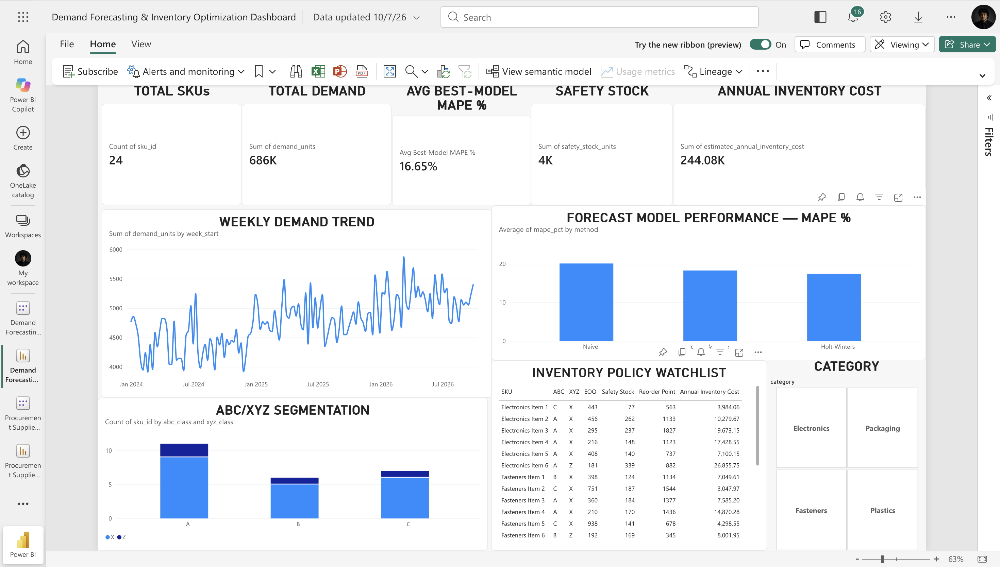

# Demand Forecasting & Inventory Optimization

An end-to-end supply chain analytics project using **Python, SQL, Excel, and Power BI** to forecast SKU-level demand and translate demand uncertainty into practical inventory policies.

## Business Problem

Inventory planners must balance two competing risks:

- Carrying too much inventory and increasing holding costs
- Carrying too little inventory and increasing stockout risk

This project evaluates historical SKU demand, compares forecasting methods, segments products by value and demand variability, and develops inventory policies using EOQ, safety stock, reorder points, and service-level targets.

---

## Dataset

The project uses a synthetic retail/manufacturing demand dataset containing:

- **24 SKUs**
- **4 product categories**
- **144 weeks of demand history**
- Approximately **686K units of total demand**
- Regular and intermittent demand patterns
- Promotion indicators
- Lead times
- Unit costs
- Ordering costs
- Holding-cost rates
- Target service levels

> The dataset is synthetic and was generated specifically for portfolio and learning purposes.

---

## Tools & Technologies

- **Python**
- **Pandas**
- **NumPy**
- **SQL**
- **Excel**
- **Power BI**
- **Statsmodels**
- **Scikit-learn**
- **SciPy**

---

## Demand Forecasting

Three forecasting approaches were evaluated using a 13-week holdout period:

| Forecast Method | Avg. MAE | Avg. RMSE | Avg. MAPE |
|---|---:|---:|---:|
| Holt-Winters | 41.11 | 52.07 | 17.41% |
| 4-Week Moving Average | 43.15 | 52.75 | 18.28% |
| Naive Forecast | 50.51 | 59.11 | 20.09% |

### SKU-Level Model Selection

Rather than applying one forecasting model to every product, the best-performing model was selected individually for each SKU based on RMSE.

- **Holt-Winters:** best for 10 SKUs
- **Naive:** best for 8 SKUs
- **4-Week Moving Average:** best for 6 SKUs

The resulting average MAPE across the selected best models was approximately **16.65%**.

---

## Inventory Optimization

Demand variability and service-level targets were translated into SKU-level inventory policies using:

- Economic Order Quantity (**EOQ**)
- Safety Stock
- Reorder Point
- Lead-Time Demand
- Target Service Level
- Ordering Cost
- Holding Cost
- Estimated Annual Inventory Cost

Key portfolio-level results:

| KPI | Result |
|---|---:|
| Total SKUs | 24 |
| Total Demand | ~686K units |
| Avg. Best-Model MAPE | 16.65% |
| Total Safety Stock | ~4K units |
| Estimated Annual Inventory Cost | ~$244.1K |

---

## ABC / XYZ Segmentation

SKUs were segmented using two complementary approaches.

### ABC Classification

Products were classified according to annual dollar usage:

- **A:** highest-value items
- **B:** medium-value items
- **C:** lower-value items

### XYZ Classification

Products were classified according to demand variability:

- **X:** stable demand
- **Y:** moderate variability
- **Z:** high or intermittent variability

Combining ABC and XYZ segmentation helps determine which products require the most forecasting and inventory-management attention.

---

## Power BI Dashboard

The interactive Power BI dashboard includes:

- Total SKU count
- Total demand
- Average best-model MAPE
- Total safety stock
- Estimated annual inventory cost
- Weekly demand trend
- Forecast-model performance comparison
- ABC/XYZ segmentation
- SKU-level inventory policy watchlist
- Category filtering



---

## SQL Analysis

The repository contains SQL scripts for:

1. Demand analysis
2. Inventory-policy analysis
3. ABC/XYZ SKU segmentation

---

## Repository Structure

```text
demand-forecasting-inventory-optimization/
│
├── data/
│   ├── raw/
│   └── processed/
│
├── notebooks/
│   ├── 01_data_exploration.ipynb
│   ├── 02_demand_forecasting.ipynb
│   └── 03_inventory_optimization.ipynb
│
├── sql/
│   ├── 01_demand_analysis.sql
│   ├── 02_inventory_analysis.sql
│   └── 03_sku_segmentation.sql
│
├── dashboard/
│   └── screenshots/
│       └── demand_forecasting_inventory_dashboard.png
│
└── README.md
